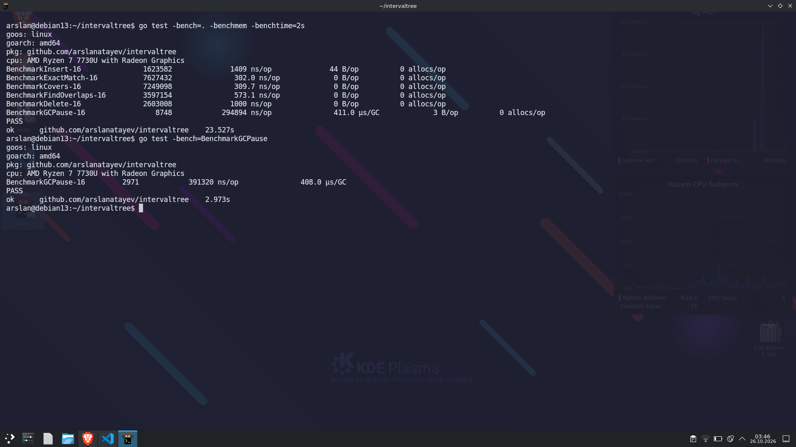
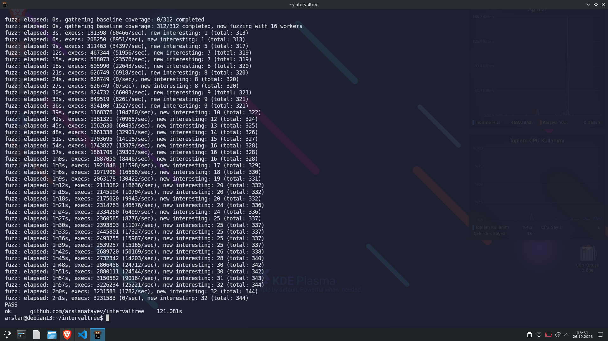

# intervaltree

[](https://pkg.go.dev/github.com/arslanatayev/intervaltree)
[](https://opensource.org/licenses/Apache-2.0)
[](https://goreportcard.com/report/github.com/arslanatayev/intervaltree)

A high-performance, memory-efficient, and pointer-free **AVL-augmented Interval Tree** written in Go using generics.

Designed with **Data-Oriented Design (DOD)** principles, `intervaltree` eliminates pointer chasing and minimizes GC overhead by storing nodes in contiguous memory backed by flat slices.

---

## Key Highlights

- **Cache-Friendly & Pointer-Free:** Nodes are indexed via `uint32` descriptors over a flat slice (`[]Node[K]`), avoiding pointer fragmentation and dramatically improving CPU cache locality.
- **Zero Heap Allocations on Hot Paths:** Query operations such as `ExactMatch` and `Covers` execute with **0 B/op and 0 allocs/op**.
- **Slot Recycling (O(1) Free-List):** Deleted node slots are recycled via an internal free-index pool, avoiding heap reallocations during continuous insert/delete cycles.
- **Recursion-Free Algorithms:** All traversals utilize fixed-size stack buffers (`[64]uint32`), preventing stack overflows and eliminating runtime frame allocations.
- **Self-Balancing AVL:** Guarantees strict O(log N) search, insertion, and deletion times with dynamic subtree `MaxEnd` rebalancing.
- **Battle-Tested:** Validated against millions of randomized fuzzing iterations and stress-tested for extreme stability.

---

## Benchmarks

Tested on **AMD Ryzen 7 7730U** (Linux amd64, Go 1.24):

```text
BenchmarkInsert-16          1623582    1409 ns/op     44 B/op    0 allocs/op
BenchmarkExactMatch-16      7627432     302.0 ns/op    0 B/op    0 allocs/op
BenchmarkCovers-16          7249098     309.7 ns/op    0 B/op    0 allocs/op
BenchmarkFindOverlaps-16    3597154     573.1 ns/op    0 B/op    0 allocs/op
BenchmarkDelete-16          2603008    1000 ns/op      0 B/op    0 allocs/op
BenchmarkGCPause-16            8748  294894 ns/op      3 B/op    0 allocs/op (411 µs/GC)
```


## Fuzz Testing Verification

The tree balance, index recycling, and overlap invariants were fuzzed over millions of operations without integrity failures or memory leaks:


## Installation

```bash
go get github.com/arslanatayev/intervaltree
```

## Quick Start

```go
package main

import (
	"cmp"
	"fmt"

	"github.com/arslanatayev/intervaltree"
)

func main() {
	// Initialize an interval tree for integers with initial capacity
	tree := intervaltree.New[int](
		1024,
		cmp.Compare[int],     // Comparison function
		func(v int) int { return v - 1 }, // Prev function
		func(v int) int { return v + 1 }, // Next function
	)

	// Insert intervals [start, end]
	tree.Insert(10, 20)
	tree.Insert(15, 25)
	tree.Insert(30, 40)

	// 1. Point / Range Coverage (Zero-alloc)
	if tree.Covers(12, 18) {
		fmt.Println("Range [12, 18] is completely covered!")
	}

	// 2. Overlap Query (Zero-alloc)
	for interval := range tree.FindOverlaps(18, 35) {
		fmt.Printf("Overlapping interval: [%d, %d]\n", interval.Start, interval.End)
	}

	// 3. Exact Match (Zero-alloc)
	exists := tree.ExactMatch(10, 20)
	fmt.Printf("Exact interval [10, 20] exists: %t\n", exists)

	// 4. Delete interval (Zero-alloc)
	tree.Delete(10, 20)
}
```

## Interval Computation Features

`intervaltree` includes discrete interval utilities to calculate range mutations prior to applying them:

### Interval Merging (`ComputeMerge`)

Computes merged bounding intervals for inserting adjacent or overlapping segments without redundant nodes:

```go
toDelete, merged, ok := tree.ComputeMerge(21, 29)
if ok {
    // Delete obsolete intervals
    for _, interval := range toDelete {
        tree.Delete(interval.Start, interval.End)
    }
    // Insert single consolidated range
    tree.Insert(merged.Start, merged.End)
}
```

### Interval Splitting / Punch-Hole (`ComputeSplit`)

Computes necessary cuts and fragment ranges when punching an interval hole through existing sets:

```go
toDelete, toAdd, ok := tree.ComputeSplit(12, 18)
if ok {
    for _, interval := range toDelete {
        tree.Delete(interval.Start, interval.End)
    }
    for _, interval := range toAdd {
        tree.Insert(interval.Start, interval.End)
    }
}
```

## Architecture

Traditional balanced trees allocate each node independently on the heap (`*Node`), introducing pointer overhead and memory fragmentation:

```text
Traditional Tree:
Heap -> [*Node] ---> [*Node] ---> [*Node] (Cache misses, heavy GC work)

This Implementation:
Memory: [ Node 0 | Node 1 | Node 2 | Node 3 | ... ] (Flat, cache-local slice)
             ^         |
             +---------+ (Referenced by 32-bit array indices)
```

1. Flat Memory Layout: All nodes reside in a single contiguous slice.
2. Compact 32-bit Indices: Nodes reference children and parents via `uint32` indices instead of 64-bit machine pointers, saving 50% memory on pointer fields.
3. Internal Memory Pool: Deleted slots are placed on a LIFO free list (`FreeIndex`) and repurposed immediately on subsequent inserts.


## Important Notes

### Boundary Safety in Custom Next/Prev Functions
The tree relies on your custom `Next` and `Prev` functions for discrete interval logic (e.g., in `ComputeMerge` and `ComputeSplit`). **The library does not perform boundary checks on arithmetic operations inside these functions.**

To avoid integer overflow/underflow or panics when reaching domain extremes (e.g., `math.MaxInt` or `math.MinInt`), you must handle boundary checks within your supplied callbacks:

```go
// Example: Safe Prev/Next functions for int
tree := intervaltree.New[int](
    1024,
    cmp.Compare[int],
    func(v int) int {
        if v == math.MinInt {
            return v // Prevent underflow
        }
        return v - 1
    },
    func(v int) int {
        if v == math.MaxInt {
            return v // Prevent overflow
        }
        return v + 1
    },
)
```

### Concurrency

Like Go standard library container types (`container/list`, `map`), `IntervalTree` is not thread-safe by default. If concurrent read/write access is required, protect instances with a `sync.RWMutex`:

```go
type SafeTree[K any] struct {
    mu   sync.RWMutex
    tree *intervaltree.IntervalTree[K]
}
```

## LICENSE

This project is licensed under the Apache license, Version 2.0. See the [LICENSE](LICENSE) file for details.
